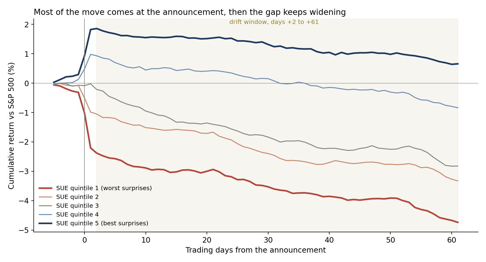
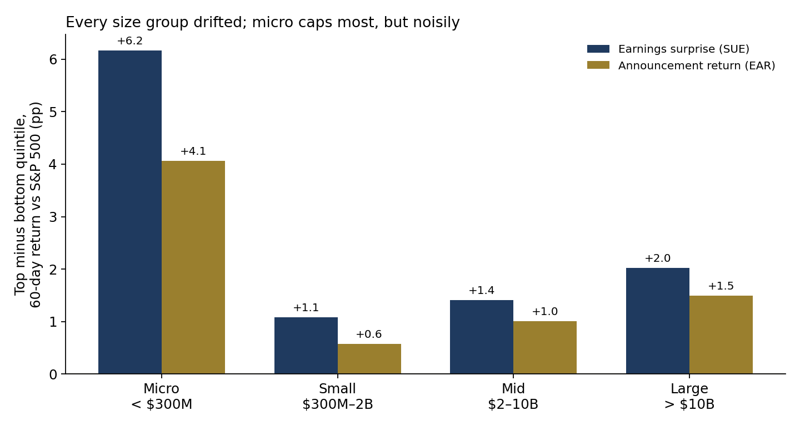
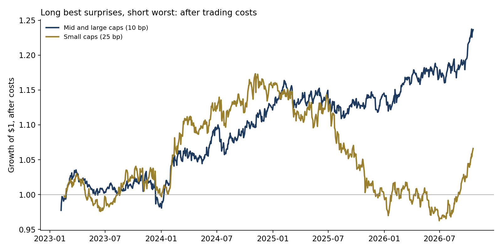
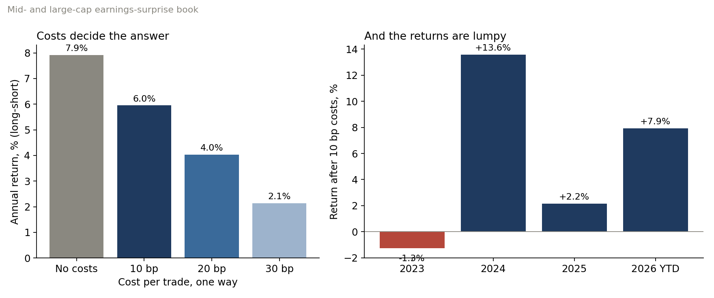

# Is post-earnings drift still tradable? 43,000 announcements, 2023–2026

**Question.** Fifty years of research say that stocks keep drifting in the direction of an earnings surprise for weeks after the announcement. Recent work argues the effect has largely gone outside the smallest stocks. On the most recent data, is there still drift, where is it, and is it worth a slot in a systematic equity book after trading costs?

**Answer, on real data.** Across 43,111 earnings announcements by 4,058 US-listed companies from January 2023 to October 2026 (price at least $5, at least $1M of daily dollar volume), the stocks with the best earnings surprises beat those with the worst by 1.7 percentage points over the 60 trading days after the announcement, measured against the S&P 500 (t = 4.2 across 15 announcement quarters). The drift was present in every size group, including large caps (2.0 points, t = 3.4). It has weakened: 2.6 points for announcements in 2023–24, 0.5 points in 2025–26. The stock's own price reaction to the announcement was a weaker signal than the earnings surprise itself (1.3 points, t = 1.4). As a calendar-time long-short book in mid and large caps, the surprise signal earned 7.9% a year before costs and 6.0% after 10 basis points per trade (Sharpe 0.93, worst drawdown 5.3%), falling to 2.1% at 30 basis points. The returns were lumpy: −1.3% in 2023, +13.6% in 2024, +2.2% in 2025 and +7.9% in 2026 to date.

Full write-up: https://www.guptagaurav.info/articles/earnings-drift

## Results

| Earnings-surprise quintile (60-day return vs S&P 500, days +2 to +61) | All | Micro < $300M | Small $300M–2B | Mid $2–10B | Large > $10B |
|---|---|---|---|---|---|
| Top minus bottom quintile | +1.7 pp | +6.2 pp | +1.1 pp | +1.4 pp | +2.0 pp |
| t-statistic, clustered by announcement quarter | 4.2 | 1.8 | 2.1 | 2.9 | 3.4 |
| Announcements 2023–24 / 2025–26 | +2.6 / +0.5 pp | +8.9 / +4.2 | +2.2 / −0.2 | +2.2 / +0.4 | +2.3 / +1.7 |

| Calendar-time long-short book (top vs bottom surprise quintile) | Before costs | After costs | Cost assumed, one way | Sharpe after costs | Worst drawdown |
|---|---|---|---|---|---|
| Mid and large caps | 7.9% a year | 6.0% | 10 bp | 0.93 | −5.3% |
| Same, at 20 / 30 bp | | 4.0% / 2.1% | | 0.64 / 0.36 | |
| Small caps | 6.6% | 1.8% | 25 bp | 0.26 | −18% |
| Micro caps | 28.6% | 20.8% | 50 bp | 0.66 | −31% (few names; not investable at size) |

The price reaction itself (EAR, days −1 to +1) as the signal: +1.3 points over 60 days (t = 1.4); top-minus-bottom on both signals together: +3.0 points.

Illustrative translation: $100M long and $100M short in mid and large caps would have earned about $6.0M a year after 10 bp costs over this period, with a worst drawdown of about $5.3M.






## Method

- **Events.** Every announcement in the earnings calendar from January 2023 to October 2026, matched to that fiscal quarter's reported EPS. Day 0 is the first trading day on or after the announcement date. Filters at day −2: price at least $5 and median daily dollar volume over the prior 20 days at least $1M.
- **Earnings surprise (SUE).** Seasonal random walk: EPS this quarter minus EPS in the same quarter a year earlier, divided by the standard deviation of the previous (up to 8, at least 4) such changes. Only past quarters enter the scaling.
- **Announcement return (EAR).** The stock's return from the close before day −1 to the close of day +1, minus the S&P 500 (SPY) over the same days.
- **No look-ahead.** Positions are formed at the close of day +1, so the drift window starts on day +2. Quintile breakpoints come only from announcements in the previous 91 days. Unit tests confirm that changing later EPS or later announcements does not change an earlier signal or quintile.
- **Outcomes.** Event time: return over days +2 to +61 minus SPY. Calendar time: each day, an equal-weighted long of all top-quintile names in their window and short of all bottom-quintile names; costs charged when a name enters and leaves.
- **Size.** Market value at day −2 from the latest reported shares outstanding.
- **Inference.** t-statistics on the quarterly averages of the top-minus-bottom spread (15 announcement quarters), so that earnings seasons are not counted as thousands of independent observations.

## Limits

- **Short history.** The announcement calendar in this source starts in January 2023, so this is under four years and one market regime, in which the average stock trailed the S&P 500.
- **Survivorship.** The price history includes many companies that were acquired, but not all failures (for example, the 2023 bank failures are missing). That probably understates the short leg.
- **Reported EPS, not analyst consensus.** The surprise is measured against the company's own history, not against forecasts. EPS values are as currently stored by the source and may include later restatements.
- **Costs and capacity** are illustrative. Micro-cap results rest on few names and are not investable at size.
- **Dividends** are not included in the price returns; over 60 days the effect on a long-short spread is small.
- Independent research on public data; not investment advice and not deployed.

## Data and citations

Data
- Earnings calendar, reported quarterly EPS, shares outstanding and daily prices, Yahoo Finance. Copy used: [huggingface.co/datasets/defeatbeta/yahoo-finance-data](https://huggingface.co/datasets/defeatbeta/yahoo-finance-data) (ODC-BY). Files pinned by sha256 in `configs/default.yaml`.

Methods referenced
- Ball, R. and Brown, P. (1968). "An Empirical Evaluation of Accounting Income Numbers." *Journal of Accounting Research* 6(2), 159–178.
- Bernard, V. and Thomas, J. (1989). "Post-Earnings-Announcement Drift: Delayed Price Response or Risk Premium?" *Journal of Accounting Research* 27 (Supplement), 1–36.
- Chan, L., Jegadeesh, N. and Lakonishok, J. (1996). "Momentum Strategies." *The Journal of Finance* 51(5), 1681–1713.
- Martineau, C. (2022). "Rest in Peace Post-Earnings Announcement Drift." *Critical Finance Review*. [doi.org/10.1561/104.00000122](https://doi.org/10.1561/104.00000122)

Code, analysis, charts and text were produced with AI assistance (Claude, by Anthropic) and reviewed by Gaurav Gupta.

## Run it

```bash
pip install -r requirements.txt
make all     # downloads the pinned files, verifies sha256, runs the pipeline
make test
```

Outputs: `reports/metrics.json`, `reports/events.csv`, `reports/figures/`. Architecture: [docs/ARCHITECTURE.md](docs/ARCHITECTURE.md).

*Independent research on public data. Not investment advice. Dollar figures are illustrative.*
