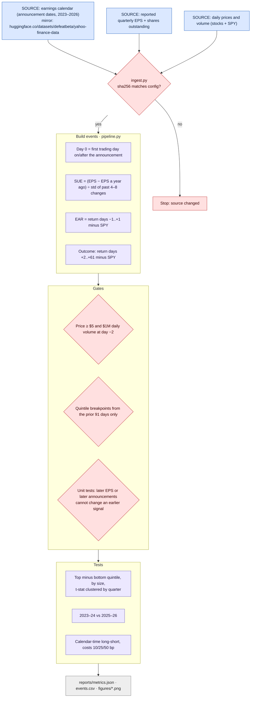
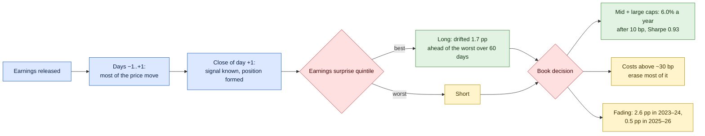

# How this project works

Colour key: **blue** = external data or market event · **lavender** = code step · **red** = check, gate or decision · **green** = good outcome · **yellow** = caution · **grey** = output

## 1. Pipeline (what `make all` runs)

## 2. The signal and the book decision

